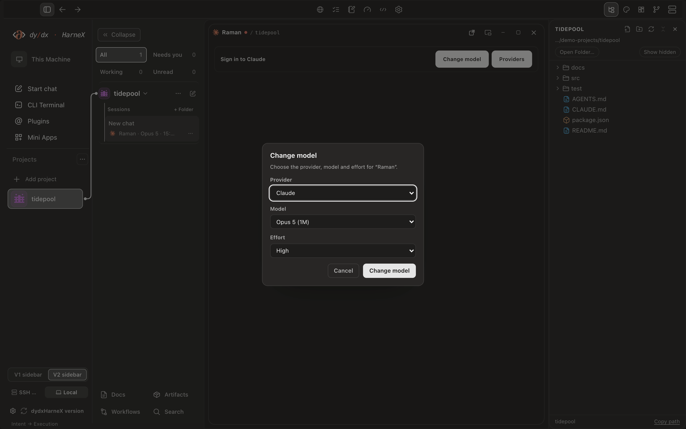
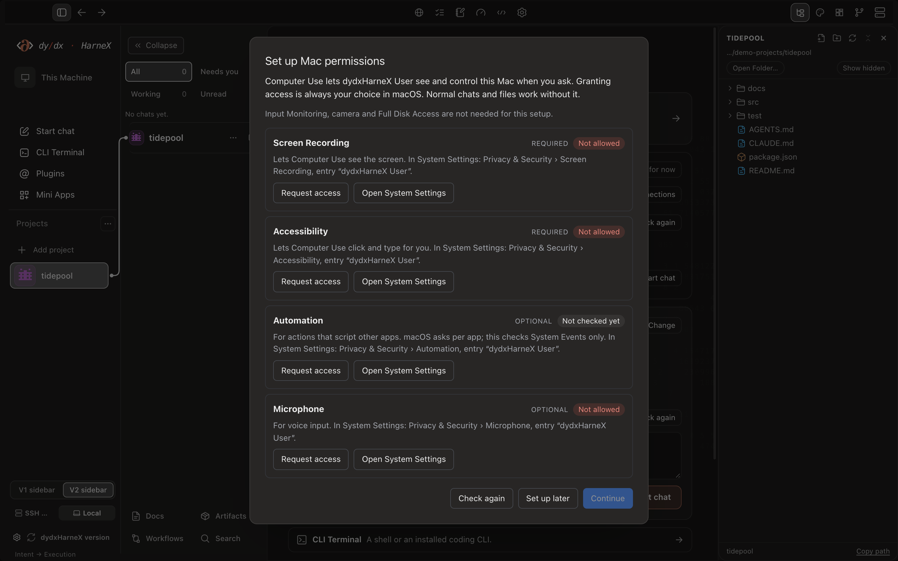

<p align="center">
  <picture>
    <source media="(prefers-color-scheme: dark)" srcset="assets/dydxharnex-user-wordmark-dark.svg">
    
  </picture>
</p>

<h1 align="center">Your coding agents. One workspace, on Mac or Windows.</h1>

<p align="center">
  Chat with Claude Code, Codex, Hermes and other agents, run their CLIs side by side,<br>
  and edit and test the same project folder without switching apps.<br>
  Your accounts, your files, your computer.
</p>

<p align="center">
  <a href="https://github.com/panditfloki/dydxharnex/releases/latest/download/dydxHarneX-User-arm64.dmg"></a>
  &nbsp;
  <a href="https://github.com/panditfloki/dydxharnex/releases/latest/download/dydxHarneX-User-Setup-x64.exe"></a>
</p>

<p align="center">
  <a href="https://github.com/panditfloki/dydxharnex/releases/latest/download/dydxHarneX-User-arm64.dmg"><b>Download for Mac (Apple Silicon)</b></a>
  &nbsp;·&nbsp;
  <a href="https://github.com/panditfloki/dydxharnex/releases/latest/download/dydxHarneX-User-Setup-x64.exe"><b>Download for Windows 11 (x64)</b></a>
  &nbsp;·&nbsp;
  <a href="https://github.com/panditfloki/dydxharnex/releases/latest">Release notes</a>
  &nbsp;·&nbsp;
  <a href="https://gitlab.com/panditftw/dydxharnex/-/releases">GitLab backup</a>
</p>

<p align="center">
  <sub>Mac v0.1.54 · Windows v0.1.51 · limited preview · Mac: macOS 12 or later, Apple Silicon, not notarized by Apple yet · Windows: Windows 11 x64, not code-signed yet · licence key required</sub>
</p>

<p align="center">
  <sub>The feature descriptions on this page cover <b>Mac 0.1.54</b>. The screenshots use the current Mac interface with fictional demo data; each caption identifies its captured version. <b>Windows 0.1.51</b> does not yet include the Mac 0.1.52 to 0.1.54 additions, such as Hermes, the current Memory settings and the current permissions setup.</sub>
</p>

<p align="center">
  <a href="#how-a-session-goes">How it works</a> ·
  <a href="#your-providers-your-subscriptions">Providers</a> ·
  <a href="#install">Install</a> ·
  <a href="#updates">Updates</a> ·
  <a href="#your-data">Your data</a>
</p>

<p align="center">
  
</p>
<p align="center"><sub>The project sidebar, editor and Files panel. Captured from the Mac 0.1.53 renderer with fictional demo files; these components are unchanged in 0.1.54.</sub></p>

## The problem it solves

A typical agent day means a Claude Code tab, a Codex tab, a plain terminal and an editor, each opened separately and each pointed at a folder you had to remember. dydxHarneX User puts them in one window, scoped to one project folder, so every chat, CLI lane, editor tab and shell starts in the right place.

## How a session goes

1. **Open the project folder once.** It appears in the sidebar with its chats underneath, and its files show up right away.
2. **Open the lanes you need.** A plain terminal, or the Claude Code, Codex, OpenCode, Grok, Kimi Code or Antigravity CLI. Each lane opens in the project folder and uses that tool's own sign-in.
3. **Start a chat and choose who answers.** Pick the agent, model and effort for that chat, plus how much it may do without asking.
4. **Split off a subagent when a task branches.** It is created as a child of the current chat in the same project, with its own provider, model and effort.
5. **Check the result where it lives.** Read and edit the file in the built-in editor, then run the tests in the terminal next to it.

## Projects and chats

- **One sidebar for every project.** Projects you open, local workspaces the app created, and linked folders you can browse and preview read-only.
- **Chats stay with their project.** Filter them by working, unread or waiting for you. Closed chats can be reopened from the list.
- **Subagents and parent chats.** A chat's menu offers **Attach to a parent chat**, **Change parent chat** and **Detach**. Parent and child stay grouped, and organising a chat keeps its history.
- **Message another chat.** Pick a loaded project and a chat, preview the message and send it. Busy chats queue it, closed chats can be reopened with **Open and send**, and only the message you compose is shared.

## Files and editor

- **Files follows your disk.** Create, paste, rename or delete something in Finder or a terminal and the Files panel updates on its own, keeping your expansion and selection. *Mac 0.1.54; not yet in Windows 0.1.51.*
- **Editor** with tabs, search and a diff review for project files. Panels open and close smoothly, and long folder paths stay readable in smaller windows.
- **File previews** can be closed, minimised and restored with the view and scroll position kept.
- **Live project preview** for what you build, such as a local dev server or a static page. Pick an element or take a screenshot and hand it to the chat.
- **Browser panel** for docs and other websites. Agents can use it only while Browser Control is on in Settings.
- **Docs, Plan and Pad** for notes, task lists and sketches next to your chats.

## Pick the agent, model and permissions per chat

<p align="center">
  
</p>
<p align="center"><sub>Change model dialog from the Mac 0.1.53 renderer, also used in 0.1.54. Fictional demo project, signed out. The displayed model names come from the build; availability depends on your connected account.</sub></p>

Each chat keeps its own choice, so a quick question can go to a small model while a hard refactor gets a larger one at higher effort.

**Ask approval**, **Auto** and **Full access** each map to that agent's own permission mode, so what they cover depends on the actions the provider supports. Permissions are set per chat and can be changed at any time. Computer settings keep the selected chat permission separate from the profile default, with temporary or explicitly remembered Full access. App permission never grants macOS access by itself. *The current permissions setup is Mac 0.1.54; not yet in Windows 0.1.51.*

### Hermes Agent, running locally

Hermes Agent is available as a local chat provider. Its models are listed as soon as you select it, before the first message, and **Refresh Providers** retries if discovery fails. Chats support replies, Stop, and approval requests in Ask and Auto for supported commands and edits. Hermes Plan and SSH modes are not included. *Mac 0.1.54; not yet in Windows 0.1.51.*

## Computer Use

With Computer Use on, an agent can see and operate the screen for the task you give it. A live monitor icon marks the chat using it, and the status banner can be dragged anywhere within the display; its position is kept for the app run. The banner stays click-through while an agent action runs so it does not get in the way, and **Escape** stops Computer Use.

First-run setup now asks for Screen Recording and Accessibility access early, with a separate optional Microphone request. **Set up later** keeps normal chats working, and the setup never restarts an active chat. *Mac 0.1.54; not yet in Windows 0.1.51.*

<p align="center">
  
</p>
<p align="center"><sub>First-run access setup from the Mac 0.1.53 renderer, unchanged in 0.1.54. Permission statuses are demo values; no macOS permission was granted for this capture.</sub></p>

## Memory Saver

**Settings > General > Memory** adds Auto/Off controls, compact rendering for large tool outputs and information about the app's own process memory. Savings across a whole real workload have not been measured yet. *Mac 0.1.54; not yet in Windows 0.1.51.*

## Also in the workspace

- **MCP servers and project plugins** in Settings. A plugin works once you connect its service; appearing in the catalog does not mean it is connected.
- **Settings search and Phone pairing** make setup easier to find. Bots links to provider and project setup when needed.
- **Pet** with show/hide, name, look, size, character, motion and voice settings. Carry, idle and walking animations are connected; Reduced motion and Still are respected.
- **Light, dark or system appearance**, with six paired palettes, custom accents and adjustable text size.
- **Mini Apps, Shot capture and detached panels** for the side tasks around a coding session.

## What's new in Mac 0.1.54

- **Updates now check GitHub first**, with a verified GitLab fallback. Both services carry the releases from 0.1.41 onward, so an installed app finds this update on whichever feed it already uses. GitHub also keeps its four earlier releases.
- Carries everything from 0.1.53: Files live refresh, Hermes as a local provider, Pet animations, the draggable Computer Use banner, Memory Saver and the first-run access setup.

Windows remains at **0.1.51** and does not yet include the Mac 0.1.52 to 0.1.54 additions. [Full Mac release notes](https://github.com/panditfloki/dydxharnex/releases/tag/v0.1.54) · [GitLab copy](https://gitlab.com/panditftw/dydxharnex/-/releases/v0.1.54).

## Your providers, your subscriptions

dydxHarneX does not sell or resell model access. Each agent signs in with your own account, and its usage counts against your plan with that provider.

| What you connect | How it works in dydxHarneX |
| --- | --- |
| Claude Code, Codex, OpenCode, Grok, Kimi Code, Antigravity | Run as CLI lanes, and as chat providers where your account allows. |
| Hermes Agent | A local chat provider. Its models come from the providers you have configured in Hermes. |
| Cursor Agent | A chat provider, using Cursor Agent's own sign-in and model list. Install its CLI and run `agent login` first. |
| API providers, such as DeepSeek, OpenRouter or Mistral | Chat through the Custom provider form with your own API key. A saved key is shown as saved, not as tested. |
| Local model servers, such as Ollama or LM Studio | Chat through Local models while the server runs on your computer. |
| Any other command-line tool | Run it in a plain terminal lane inside the project folder. |

Nothing is connected until you sign in or add a key yourself, and no model usage is included. The Connections card under **Settings > Providers** shows what is installed and signed in. Provider updates target the installation you selected, and wait for active work using that provider. Chat requests go to your selected provider under its terms. Optional integrations such as Jev have their own opt-in and service terms.

## Requirements

- **Mac:** Apple Silicon (M1 or later) with macOS 12 Monterey or later. Intel Macs are not supported.
- **Windows:** Windows 11 on an x64 PC. Windows 10 and Arm PCs are not supported.
- At least one AI account of your own: a coding CLI you are signed in to, an API key, or a local model server.
- An email address and licence key issued to you by DYDXFX.

## Limited preview

dydxHarneX User is a limited preview: Mac 0.1.54 and Windows 0.1.51. It activates with the email address and licence key issued to you by DYDXFX. Free trials and paid plans are not open yet; they come with the paid launch later. The Mac build is ad-hoc signed and not notarized by Apple, and the Windows build is not code-signed yet, so the first launch needs one extra step (below).

**Settings > Account** shows your account and licence, with logout and account switching. About shows the installed version and edition, opens the product and legal pages, and keeps update results inline. The app stops safely when a licence ends.

[Website](https://www.dydxfx.com/harnex/) · [Privacy policy](https://www.dydxfx.com/harnex/privacy.html) · [Terms of sale](https://www.dydxfx.com/harnex/terms.html)

## Install

GitHub is the primary download. The same installers are also published on GitLab as a backup. Each service has its own signed update manifest that points at its own copies, so the download addresses differ while the installers are the same.

### Mac

**[Download dydxHarneX User for Mac (Apple Silicon)](https://github.com/panditfloki/dydxharnex/releases/latest/download/dydxHarneX-User-arm64.dmg)** · [GitLab backup](https://gitlab.com/panditftw/dydxharnex/-/releases/permalink/latest/downloads/dydxHarneX-User-arm64.dmg)

1. Open the DMG and drag **dydxHarneX User** onto **Applications**.
2. Eject the dydxHarneX disk.

Every release lists the SHA-256 of each file next to it. To check a download:

```sh
shasum -a 256 ~/Downloads/dydxHarneX-User-arm64.dmg
```

#### First open on Mac

macOS blocks the first launch because the app is not notarized yet. You only do this once.

<details>
<summary><b>Show the first-open steps</b></summary>

**macOS 15 Sequoia or later**

1. Open dydxHarneX User from Applications. macOS says it cannot verify the app. Click Done.
2. Open System Settings > Privacy & Security, scroll down and click **Open Anyway** next to dydxHarneX User. Confirm with your password.

**macOS 12 to 14**

Right-click (or Control-click) dydxHarneX User in Applications, choose Open, then click Open again.

If macOS still refuses the app, verify the download checksum and get a fresh copy from the release page before trying again.

</details>

On first run the app asks for Screen Recording and Accessibility access, and optionally the Microphone. You can choose **Set up later** and grant them from Settings when you need Computer Use or voice.

### Windows

**[Download Setup.exe for Windows 11 (x64)](https://github.com/panditfloki/dydxharnex/releases/latest/download/dydxHarneX-User-Setup-x64.exe)** · [GitLab backup](https://gitlab.com/panditftw/dydxharnex/-/releases/permalink/latest/downloads/dydxHarneX-User-Setup-x64.exe)

1. Finish active work and quit the previous dydxHarneX User app.
2. Run **dydxHarneX-User-Setup-x64.exe** and follow the installer. It installs for your Windows account without administrator rights and adds a Start menu entry.
3. This preview is not code-signed. If Windows shows **Windows protected your PC**, use **More info > Run anyway** only after checking that this is the file you downloaded here. If **Smart App Control** blocks it, this unsigned preview cannot be opened on that PC; do not disable that protection.
4. Open **dydxHarneX User** from the Start menu and activate it with your issued licence.

To check the installer against the release checksum in PowerShell:

```powershell
Get-FileHash -Algorithm SHA256 "$env:USERPROFILE\Downloads\dydxHarneX-User-Setup-x64.exe"
```

The ZIP package ([GitHub](https://github.com/panditfloki/dydxharnex/releases/latest/download/dydxHarneX-User-win-x64.zip) · [GitLab](https://gitlab.com/panditftw/dydxharnex/-/releases/permalink/latest/downloads/dydxHarneX-User-win-x64.zip)) remains available for manual extraction. Extract it fully before opening **dydxHarneX User.exe**; an uninstalled copy does not update itself.

To uninstall, use **Settings > Apps > dydxHarneX User > Uninstall**. Your chats, settings and licence stay in your Windows user profile.

## Updates

**Mac 0.1.54:** In an installed 0.1.41 through 0.1.53, use **Check for Updates**, finish active work, then restart when the update is ready. Your installed app finds 0.1.54 on the feed it already uses; from 0.1.54 on, update checks go to GitHub first and fall back to GitLab when GitHub cannot be reached. If 0.1.46 fails before installing the update, its old helper may have been stopped by macOS; install the current DMG once after saving work and quitting the app. Keep the existing User profile.

**Windows 0.1.51:** In an installed copy, click the version at the bottom left of the sidebar to check for updates, finish active work, then restart when the update is ready. Or quit the app and run the current Setup.exe over the existing installation. Keep the existing User profile. Windows continues to use its existing signed update feed.

**Older Mac installs (0.1.40 or earlier):** The GitHub update feed is live again, so first save your work and choose **dydxHarneX User > Check for Updates**. Only if the older updater cannot complete, download the current DMG, quit the old app, and replace it in Applications. Keep your existing profile; the app identity and data locations are unchanged. Later updates use **Check for Updates**.

The app checks for signed updates on launch and every 6 hours. To check now, click the version at the bottom left of the sidebar, or on Mac choose **dydxHarneX User > Check for Updates**. The result appears inline in the sidebar. On Windows only the installed copy updates itself; a copy started without installing points you to the release page.

Each update is verified against a DYDXFX signing key and a SHA-256 checksum, whichever service it came from, and nothing installs until you say so. Once a download is ready, **Restart now** checks for active tasks again. **Update waiting** reopens the panel if you dismissed it. If the app cannot confirm activity, it waits and explains why.

## Your data

Your project files stay in the folders you open; dydxHarneX works on them in place. Chats, settings and app state are kept in a local profile: `~/Library/Application Support/dydxHarneX-User` on Mac, `%APPDATA%\dydxHarneX-User` on Windows. On Windows the app itself installs to `%LOCALAPPDATA%\Programs\dydxHarneX User`. Chat requests go to the provider you choose. If you enable optional Jev assistance with your own TypeSafe key, the relevant task context is also sent to TypeSafe for its suggestions and separate billing. Your AI accounts and their usage stay with each provider.

## Licence

dydxHarneX User is proprietary software. Using it requires a licence issued by DYDXFX. This repository holds release downloads only and contains no source code. See the [notice](LICENSE).
<p align="center"><sub>Screenshots show the packaged Mac 0.1.53 renderer in an isolated browser harness with fictional demo data and shortened local paths. These pictured components are unchanged in Mac 0.1.54. Windows 0.1.51 does not yet include the Mac 0.1.52 to 0.1.54 additions. Provider names belong to their owners.</sub></p>

<p align="center"><sub>© 2026 dydxfx · <a href="https://dydxfx.com">dydxfx.com</a></sub></p>
