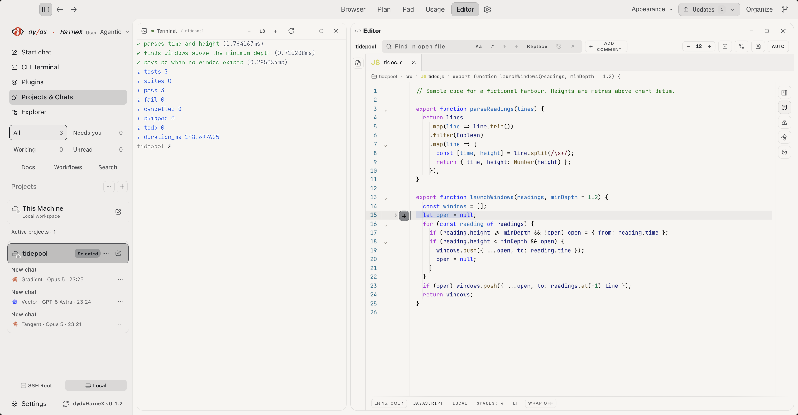
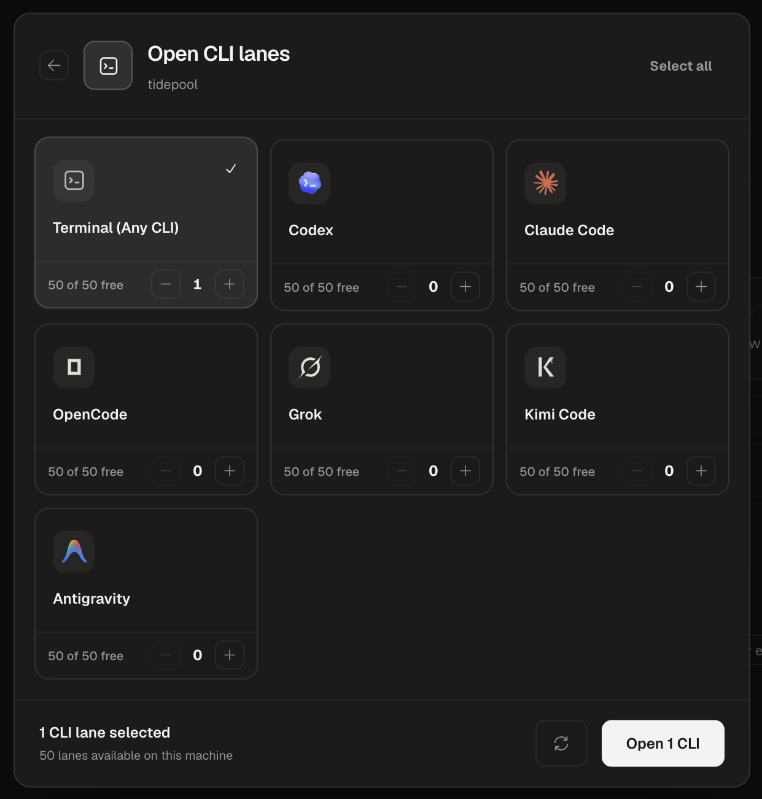
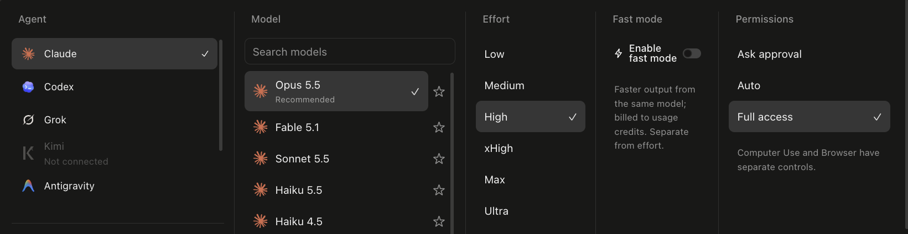
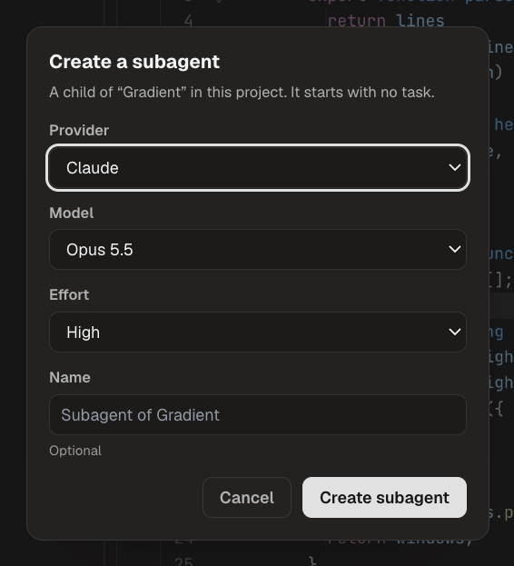
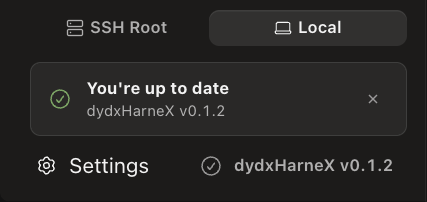

<p align="center">
  <picture>
    <source media="(prefers-color-scheme: dark)" srcset="assets/dydxharnex-user-wordmark-dark.svg">
    
  </picture>
</p>

<h1 align="center">Your coding agents. One workspace, on Mac or Windows.</h1>

<p align="center">
  Chat with Claude Code, Codex and other agents, run their CLIs side by side,<br>
  and edit and test the same project folder without switching apps.<br>
  Your accounts, your files, your computer.
</p>

<p align="center">
  <a href="https://gitlab.com/panditftw/dydxharnex/-/releases/permalink/latest/downloads/dydxHarneX-User-arm64.dmg"></a>
  &nbsp;
  <a href="https://gitlab.com/panditftw/dydxharnex/-/releases/permalink/latest/downloads/dydxHarneX-User-win-x64.zip"></a>
</p>

<p align="center">
  <a href="https://gitlab.com/panditftw/dydxharnex/-/releases/permalink/latest/downloads/dydxHarneX-User-arm64.dmg"><b>Download for Mac (Apple Silicon)</b></a>
  &nbsp;·&nbsp;
  <a href="https://gitlab.com/panditftw/dydxharnex/-/releases/permalink/latest/downloads/dydxHarneX-User-win-x64.zip"><b>Download for Windows 11 (x64)</b></a>
  &nbsp;·&nbsp;
  <a href="https://gitlab.com/panditftw/dydxharnex/-/releases/permalink/latest">Release notes</a>
</p>

<p align="center">
  <sub>Mac v0.1.44 · Windows v0.1.42 · limited preview · Mac: macOS 12 or later, M1 or later, not notarized by Apple yet · Windows: Windows 11 x64, not code-signed yet · licence key required</sub>
</p>

<p align="center">
  <a href="#how-a-session-goes">How it works</a> ·
  <a href="#your-providers-your-subscriptions">Providers</a> ·
  <a href="#install">Install</a> ·
  <a href="#updates">Updates</a> ·
  <a href="#your-data">Your data</a>
</p>

<picture>
  <source media="(prefers-color-scheme: dark)" srcset="assets/workspace-dark.png">
  
</picture>

<p align="center"><sub>The real dydxHarneX User 0.1.2 window, in light and dark appearance. <i>tidepool</i> is a fictional sample project made for this page; the terminal shows an actual run of its tests.</sub></p>

## The problem it solves

A typical agent day means a Claude Code tab, a Codex tab, a plain terminal and an editor, each opened separately and each pointed at a folder you had to remember. dydxHarneX User puts them in one window, scoped to one project folder, so every chat, CLI lane, editor tab and shell starts in the right place.

## How a session goes

1. **Open the project folder once.** It appears in the sidebar with its chats underneath.
2. **Open the lanes you need.** A plain terminal, or the Claude Code, Codex, OpenCode, Grok, Kimi Code or Antigravity CLI. Each lane opens in the project folder and uses that tool's own sign-in.
3. **Start a chat and choose who answers.** Pick the agent, model and effort for that chat, plus how much it may do without asking.
4. **Split off a subagent when a task branches.** It is created as a child of the current chat in the same project, with its own provider, model and effort.
5. **Check the result where it lives.** Read and edit the file in the built-in editor, then run the tests in the terminal next to it.

<p align="center">
  
</p>
<p align="center"><sub>Open several CLI lanes for a project in one step. Only tools installed on your Mac can run.</sub></p>

## Pick the agent, model and effort per chat

<p align="center">
  
</p>
<p align="center"><sub>One picker for agent, model, effort and permissions. The models and effort levels you see depend on the provider, the model and your account.</sub></p>

Each chat keeps its own choice, so a quick question can go to a small model while a hard refactor gets a larger one at higher effort. Permissions are set per chat as **Ask approval**, **Auto** or **Full access**. Each maps to that agent's own permission mode, so what it covers depends on the actions the provider supports, and you can change it at any time.

## Branch work into subagents

<p align="center">
  
</p>
<p align="center"><sub>A subagent is linked to its parent chat and starts with no task until you give it one.</sub></p>

The parent and child stay grouped in the sidebar, so you can see which conversation a side task came from.

## Also in the workspace

- **Explorer and editor** with file tree, tabs, search and a diff review for project files.
- **Live project preview** for what you build, such as a local dev server or a static page. Pick an element or take a screenshot and hand it to the chat.
- **Browser panel** for docs and other websites. Agents can use it only while Browser Control is on in Settings. Its saved On/Off choice and any save error are shown in Mac 0.1.44.
- **Computer settings** separate the selected chat permission from the profile default, with temporary or explicitly remembered Full access and clearer macOS permission requests. App permission does not grant macOS access.
- **Settings search and Phone pairing** make setup easier to find; Bots links to provider and project setup when needed.
- **MCP servers and project plugins** in Settings. A plugin works once you connect its service; appearing in the catalog does not mean it is connected.
- **Projects and chats sidebar** with filters for chats that are working, unread or waiting for you.
- **Light, dark or system appearance**, with six paired palettes, custom accents and adjustable text size. Light-mode accent selection and focus colours are corrected in Mac 0.1.43.
- **Docs, Plan and Pad** for notes, task lists and sketches next to your chats.

## Your providers, your subscriptions

dydxHarneX does not sell or resell model access. Each agent signs in with your own account, and its usage counts against your plan with that provider.

| What you connect | How it works in dydxHarneX |
| --- | --- |
| Claude Code, Codex, OpenCode, Grok, Kimi Code, Antigravity | Run as CLI lanes, and as chat providers where your account allows. |
| Cursor Agent | A chat provider, using Cursor Agent's own sign-in and model list. Install its CLI and run `agent login` first. |
| API providers, such as DeepSeek, OpenRouter or Mistral | Chat through the Custom provider form with your own API key. A saved key is shown as saved, not as tested. |
| Local model servers, such as Ollama or LM Studio | Chat through Local models while the server runs on your Mac. |
| Any other command-line tool | Run it in a plain terminal lane inside the project folder. |

Nothing is connected until you sign in or add a key yourself, and no model usage is included. The Connections card under Settings > Providers shows what is installed and signed in on your Mac. When you send a message, that request goes to the provider you chose for that chat, under that provider's terms.

## Requirements

- **Mac:** Apple Silicon (M1 or later) with macOS 12 Monterey or later. Intel Macs are not supported.
- **Windows:** Windows 11 on an x64 PC. Windows 10 and Arm PCs are not supported.
- At least one AI account of your own: a coding CLI you are signed in to, an API key, or a local model server.
- An email address and licence key issued to you by DYDXFX.

## Limited preview

dydxHarneX User is a limited preview: Mac 0.1.44 and Windows 0.1.42. It activates with the email address and licence key issued to you by DYDXFX. Free trials and paid plans are not open yet; they come with the paid launch later. The Mac build is not notarized by Apple and the Windows build is not code-signed yet, so the first launch needs one extra step (below).

**Settings > Account** shows your account and licence with confirmed logout/account switching. About shows the installed version and User edition, opens the product/legal pages, and keeps update results inline. **0.1.40** adds the Start card, Artifacts, clear delivery states for every message and a safe stop when a licence ends. See the [release notes](https://gitlab.com/panditftw/dydxharnex/-/releases/permalink/latest).

[Website](https://www.dydxfx.com/harnex/) · [Privacy policy](https://www.dydxfx.com/harnex/privacy.html) · [Terms of sale](https://www.dydxfx.com/harnex/terms.html)

## Install

### Mac

**[Download dydxHarneX User for Mac (Apple Silicon)](https://gitlab.com/panditftw/dydxharnex/-/releases/permalink/latest/downloads/dydxHarneX-User-arm64.dmg)**

1. Open the DMG and drag **dydxHarneX User** onto **Applications**.
2. Eject the dydxHarneX disk.

Every release lists the SHA-256 of each file next to it. To check a download:

```sh
shasum -a 256 ~/Downloads/dydxHarneX-User-arm64.dmg
```

#### First open on Mac

macOS blocks the first launch because the app is not notarized yet. You only do this once.

<details>
<summary><b>Show the first-open steps</b></summary>

**macOS 15 Sequoia or later**

1. Open dydxHarneX User from Applications. macOS says it cannot verify the app. Click Done.
2. Open System Settings > Privacy & Security, scroll down and click **Open Anyway** next to dydxHarneX User. Confirm with your password.

**macOS 12 to 14**

Right-click (or Control-click) dydxHarneX User in Applications, choose Open, then click Open again.

If macOS says the app "is damaged and can't be opened", run this once in Terminal, then open the app normally:

```sh
xattr -dr com.apple.quarantine "/Applications/dydxHarneX User.app"
```

</details>

### Windows

**[Download dydxHarneX User for Windows 11 (x64)](https://gitlab.com/panditftw/dydxharnex/-/releases/permalink/latest/downloads/dydxHarneX-User-win-x64.zip)**

1. Right-click the downloaded zip and choose **Extract All**. Do not start the app from inside the zip.
2. Open the extracted **dydxHarneX User-win32-x64** folder and run **dydxHarneX User.exe**.
3. The app is not code-signed yet, so Windows shows **Windows protected your PC**. Choose **More info**, then **Run anyway**. You only do this once. On PCs where **Smart App Control** is on, Windows blocks unsigned apps and this preview cannot be opened.
4. Choose **Install**. It installs for your Windows account only, without administrator rights, adds a Start menu entry and an entry in **Settings > Apps**, and opens.

To check a download in PowerShell:

```powershell
Get-FileHash -Algorithm SHA256 "$env:USERPROFILE\Downloads\dydxHarneX-User-win-x64.zip"
```

To uninstall, use **Settings > Apps > dydxHarneX User > Uninstall**. Your chats, settings and licence stay in your Windows user profile.

## Updates

**Moving from GitHub:** 0.1.41 uses this GitLab project for signed updates and downloads. If your installed 0.1.40 cannot reach its old GitHub feed, download the current package for your platform here and install it once. Finish active work and quit the old app first. Keep your existing profile; the app identity and data locations are unchanged. Later updates use **Check for Updates**.

<p align="center">
  
</p>

The app checks this repository for signed updates on launch and every 6 hours. To check now, click the version at the bottom left of the sidebar, or on Mac choose **dydxHarneX User > Check for Updates**. The result appears inline in the sidebar. On Windows only the installed copy updates itself; a copy started without installing points you to the release page.

Each update is verified against a DYDXFX signing key and a SHA-256 checksum, and nothing installs until you say so.

Once a download is ready, **Restart now** checks for active tasks again. **Update waiting** reopens the panel if you dismissed it. If the app cannot confirm activity, it waits and explains why.

On Mac, when upgrading from 0.1.3 or earlier, your installed updater handles that first upgrade. The new **Restart now** button appears after 0.1.31 is installed. If the old updater stays at **Update waiting** with no active work, download the DMG, quit User after saving your work, and replace the app in Applications. Keep your existing User profile to retain saved chats and settings.

## Your data

Your project files stay in the folders you open; dydxHarneX works on them in place. Chats, settings and app state are kept in a local profile: `~/Library/Application Support/dydxHarneX-User` on Mac, `%APPDATA%\dydxHarneX-User` on Windows. On Windows the app itself installs to `%LOCALAPPDATA%\Programs\dydxHarneX User`. When you send a message, it goes only to the provider you chose for that chat. Your AI accounts and their usage stay with each provider.

## Licence

dydxHarneX User is proprietary software. Using it requires a licence issued by DYDXFX. This repository holds release downloads only and contains no source code. See the [notice](LICENSE).

<p align="center"><sub>Screenshots show dydxHarneX User 0.1.2 with a fictional sample project. Provider names belong to their owners.</sub></p>

<p align="center"><sub>© 2026 dydxfx · <a href="https://dydxfx.com">dydxfx.com</a></sub></p>
